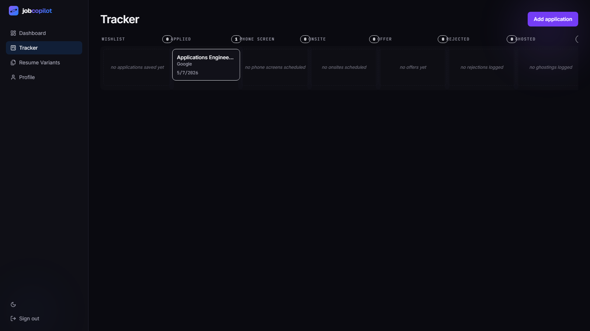
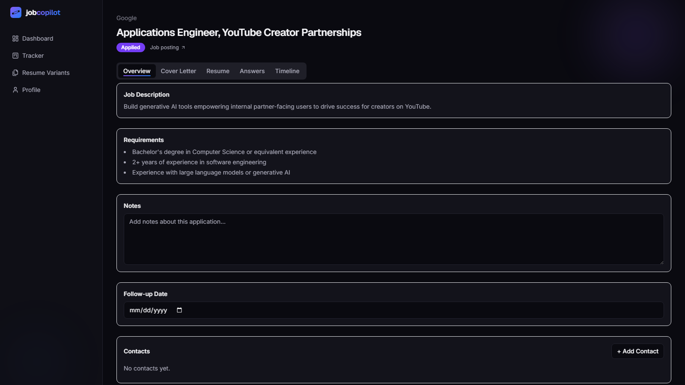
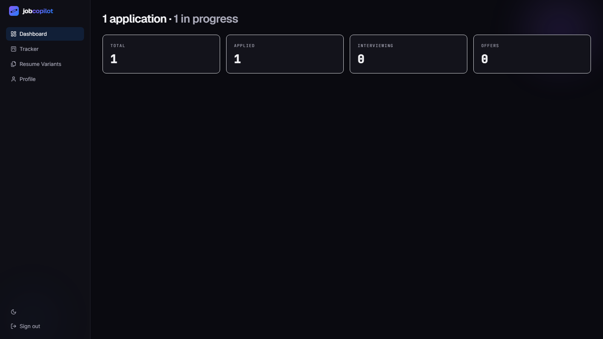
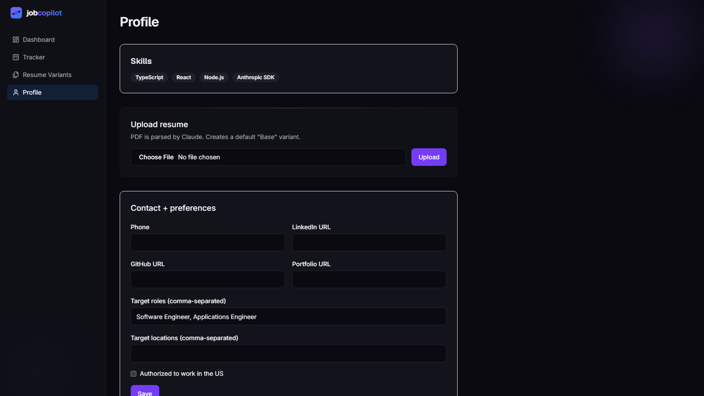
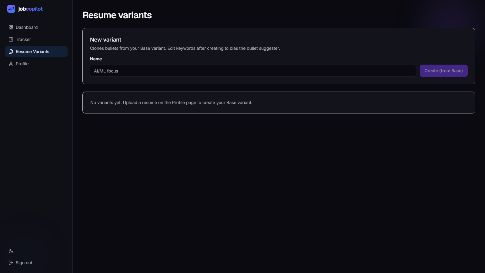
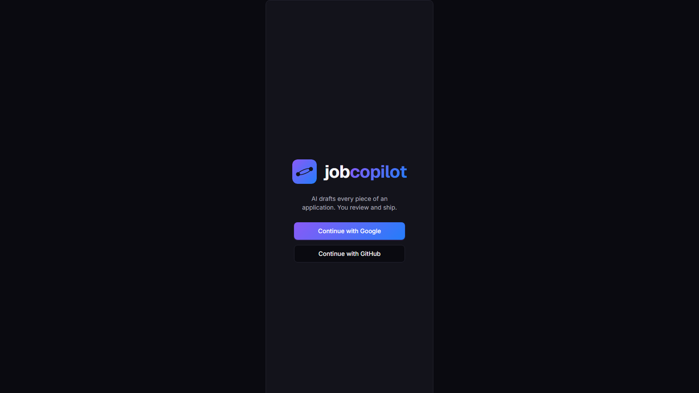

<p align="center">
  
</p>

<p align="center">
  <a href="https://jobcopilot.vercel.app/">Watch the live landing →</a>
</p>

# JobCopilot

Personal AI-assisted job application tool. AI drafts every piece of an application (cover letter, resume bullet tweaks, free-text answers); the human reviews and submits. See `docs/specs/2026-04-14-job-hunt-copilot-design.md` for the full design.

## Preview

<table>
  <tr>
    <td width="50%"></td>
    <td width="50%"></td>
  </tr>
  <tr>
    <td align="center"><sub><strong>Tracker</strong> · 7-stage kanban</sub></td>
    <td align="center"><sub><strong>Application</strong> · AI drafter + answer suggester</sub></td>
  </tr>
  <tr>
    <td width="50%"></td>
    <td width="50%"></td>
  </tr>
  <tr>
    <td align="center"><sub><strong>Dashboard</strong> · pipeline at a glance</sub></td>
    <td align="center"><sub><strong>Profile</strong> · resume-parsed skills + contact</sub></td>
  </tr>
  <tr>
    <td width="50%"></td>
    <td width="50%"></td>
  </tr>
  <tr>
    <td align="center"><sub><strong>Resume Variants</strong> · keyword-biased clones</sub></td>
    <td align="center"><sub><strong>Login</strong> · OAuth-only</sub></td>
  </tr>
</table>

## Stack

Next.js 14 · TypeScript · Supabase · Prisma · Claude API · Tailwind + shadcn/ui · Vitest + Playwright.

## Development

Prerequisites: Node 20 LTS, pnpm (version pinned via `packageManager` in root `package.json`; Corepack will enforce it), Supabase project (URL + anon + service-role keys), Anthropic API key.

```bash
pnpm install
cp .env.example .env                    # fill in Supabase + Anthropic keys
pnpm -F @jobcopilot/db db:push          # push schema to Supabase
pnpm -F @jobcopilot/db apply:policies   # apply RLS policies
pnpm dev                                # starts apps/web on :3000
```

Sign in with Google or GitHub.

## Monorepo layout

- `apps/web`: Next.js 14 web app
- `packages/db`: Prisma schema + Supabase RLS policies
- `packages/shared`: shared types + Zod schemas
- `packages/prompts`: Claude prompt templates + eval harness

## Tests

```bash
pnpm test                          # unit + integration (vitest)
pnpm test:e2e                      # playwright e2e (auto-starts dev server with mocks)
pnpm -F @jobcopilot/prompts eval   # prompt regression harness
```

## Deploy

See `docs/DEPLOY.md`.
